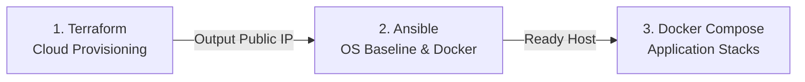

# cloud-infra-kit

A clean, modular, and beginner-friendly **Infrastructure as Code (IaC)** starter kit for provisioning cloud servers with Terraform, configuring baseline OS environments with Ansible, and deploying Docker ready hosts.

---

## Supported Cloud Providers

| Provider | Path | Status | Description |
|---|---|---|---|
| **Oracle Cloud (OCI)** | [`oracle-cloud/`](oracle-cloud/) | ✅ **Ready** | Always Free Tier ARM64 (4 OCPU, 24GB RAM, 200GB Disk) + Docker |
| **Amazon Web Services** | [`aws/`](aws/) | 🚧 Roadmap | Baseline VPC, EC2 t4g/t3-micro, and Docker Engine |
| **Google Cloud (GCP)** | [`gcp/`](gcp/) | 🚧 Roadmap | e2-micro Always Free Compute Engine template |

---

## Quick Navigation

- [Oracle Cloud Starter Guide](oracle-cloud/README.md)
- [Multi-Cloud Contribution Guidelines](CONTRIBUTING.md)
- [Security Policy](SECURITY.md)

---

## Architecture Pattern

Every cloud provider module inside this repository follows a clean, standardized three-tier workflow:

1. **Terraform**: Creates the Virtual Cloud Network (VCN/VPC), Firewall/Security Rules, and Compute Instance.
2. **Ansible**: Prepares 4GB Swap, applies SSH hardening, configures Fail2ban, and installs Docker CE + Compose plugin.
3. **Docker Stacks**: Runs containerized workloads immediately on the provisioned host.
