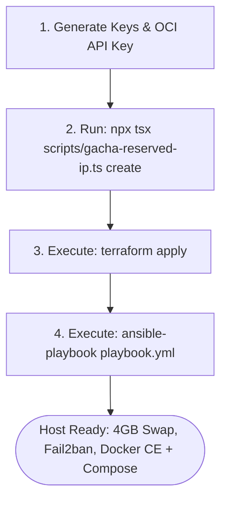

# Oracle Cloud (OCI) Always Free Starter Kit

This module provides a reproducible blueprint to provision and bootstrap an Oracle Cloud Always Free ARM64 compute instance (4 OCPU, 24GB RAM, 200GB Boot Disk) ready for Docker workloads.

---

## Architecture Flow



---

## 1. Quick Start Guide

### Step 1: Install Local Tooling Dependencies
```bash
cd oracle-cloud
npm install
```

### Step 2: Set Up Credentials in `keys/`
```bash
mkdir -p keys && chmod 700 keys

# 1. Generate SSH keypair
ssh-keygen -t ed25519 -N "" -C "oracle-vps" -f keys/id_ed25519_oracle
chmod 600 keys/id_ed25519_oracle
chmod 644 keys/id_ed25519_oracle.pub

# 2. Add OCI API Key from OCI Console -> User Settings -> API Keys
# Save private key as keys/oci_api_key.pem (chmod 600)
# Copy config preview to keys/oci_config (chmod 600)
```

### Step 3: Allocate a Reserved Static Public IP
```bash
npx tsx scripts/gacha-reserved-ip.ts create
```
*Note the allocated IP address and its OCID.*

### Step 4: Provision Cloud Infrastructure (Terraform)
```bash
cd terraform
cp terraform.tfvars.example terraform.tfvars
# Edit terraform.tfvars with your tenancy_ocid, user_ocid, compartment_ocid, and fingerprint

terraform init
terraform import oci_core_public_ip.reserved_ip <RESERVED_IP_OCID>
terraform plan
terraform apply
```

### Step 5: Configure OS & Install Docker (Ansible)
```bash
cd ../ansible
# Set the public IP in inventory.ini
nano inventory.ini

ansible-playbook playbook.yml
```

---

## 2. Testing Your First Container

SSH into the provisioned host:
```bash
ssh -i keys/id_ed25519_oracle ubuntu@<YOUR_SERVER_IP>
```

Verify Docker installation:
```bash
docker --version
docker compose version
```

Start the starter test container:
```bash
cd ~/stacks
docker compose up -d
curl http://localhost
```
